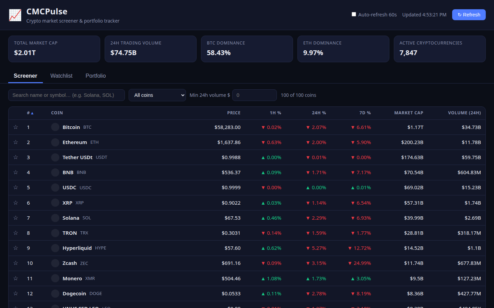
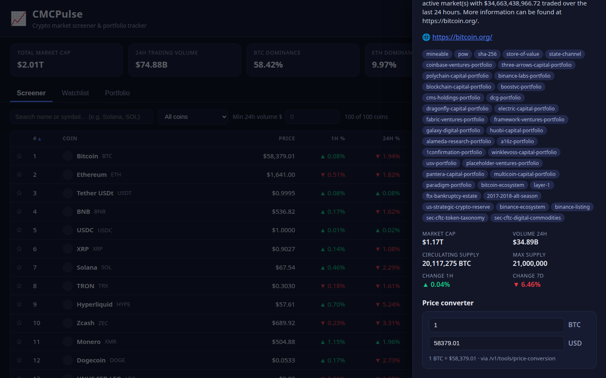
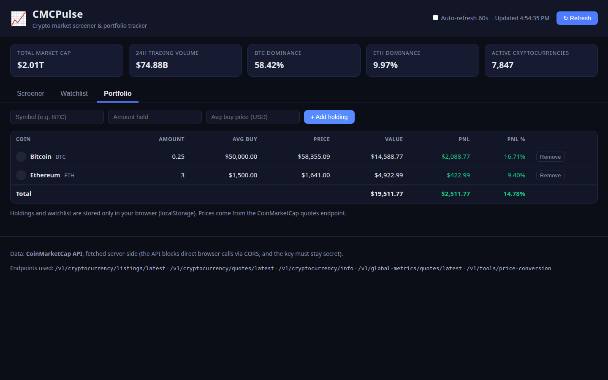
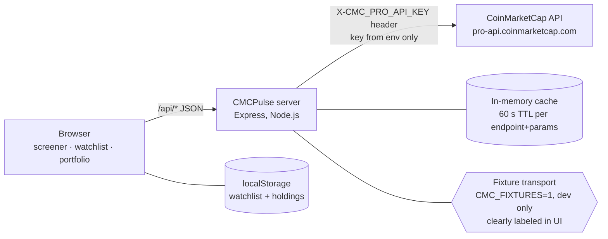

# CMCPulse — Crypto Market Screener & Portfolio Tracker

**Track: Markets and Trading Tools** · Built for *Build with CMC: API Hackathon Round 2*

CMCPulse is a working market terminal for ordinary crypto holders: screen the
top 100 coins, star a watchlist, and track a portfolio's profit/loss against
your own average buy prices — all priced live by the CoinMarketCap API, with a
coin-detail drawer and a price converter one click away.

## Screenshots

Live data from the CoinMarketCap API (captured 2026-11-25):

**Screener — top 100 with the global market header**



**Coin detail drawer with the price converter (1 BTC in USD, via `/v1/tools/price-conversion`)**



**Portfolio PnL against average buy prices**



## Features

- **Market header** — total market cap, 24h volume, BTC & ETH dominance, active
  cryptocurrency count (`/v1/global-metrics/quotes/latest`).
- **Screener** — top 100 by market cap with rank, logo, price, 1h/24h/7d %,
  market cap and 24h volume; sortable columns, text search, gainers/losers and
  minimum-volume filters, optional 60 s auto-refresh
  (`/v1/cryptocurrency/listings/latest`).
- **Coin detail drawer** — description, website, tags, supply stats from the
  metadata endpoint (`/v1/cryptocurrency/info`) plus a **price converter**
  (coin ⇄ USD) powered by `/v1/tools/price-conversion`.
- **Watchlist** — star coins; priced on demand via
  `/v1/cryptocurrency/quotes/latest`. Persisted in your browser.
- **Portfolio PnL** — add holdings (symbol, amount, average buy price); live
  valuation and per-coin + total profit/loss via the quotes endpoint.
  Persisted in your browser.
- **Honest failure UX** — no mock data is ever silently substituted. If the
  API is down or the key is wrong, the UI shows exactly what failed; if a
  refresh fails after data was loaded, the stale copy is served with a
  visible "stale" warning.

## Architecture

The CMC API **blocks browser calls via CORS by design** — an API key must
never be visible to end users. So CMCPulse is a single Node.js app: the same
process serves the frontend and proxies API calls, holding the key in a
server-side environment variable only.



Server-side responses are cached for 60 s (configurable) because CMC plans
meter **call credits per request** — a popular dashboard shouldn't burn one
credit per visitor for data that updates about once a minute anyway.

## Setup

```bash
cp .env.example .env      # then put your key in CMC_API_KEY
npm install
npm start                 # http://localhost:3000
```

Get a key at [pro.coinmarketcap.com](https://pro.coinmarketcap.com). During
the hackathon, registering on DoraHacks upgrades your CMC account to the free
Startup tier for the event window.

Configuration (`.env`):

| Variable | Default | Purpose |
|----------|---------|---------|
| `CMC_API_KEY` | — (required live) | Your CMC key. Server-side only; never committed, never sent to the browser. |
| `CMC_BASE_URL` | `https://pro-api.coinmarketcap.com` | Use `https://sandbox-api.coinmarketcap.com` for CMC's mock-data sandbox with the free test key printed in CMC's Quick Start docs. |
| `PORT` | `3000` | HTTP port. |
| `CMC_CACHE_TTL_MS` | `60000` | Server cache TTL. |
| `CMC_FIXTURES` | unset | `1` = development fixture transport (recorded, documented-shape responses; UI labels it). Never for production. |

## Endpoints used

| CMC endpoint | CMCPulse route | Powers |
|--------------|----------------|--------|
| `GET /v1/cryptocurrency/listings/latest` | `GET /api/listings` | Screener |
| `GET /v1/cryptocurrency/quotes/latest` | `GET /api/quotes` | Watchlist, portfolio, drawer quote |
| `GET /v1/cryptocurrency/info` | `GET /api/info` | Detail drawer metadata |
| `GET /v1/global-metrics/quotes/latest` | `GET /api/global-metrics` | Market header |
| `GET /v1/tools/price-conversion` | `GET /api/convert` | Converter widget |

Full request/response evidence: [`docs/api-evidence/`](docs/api-evidence/endpoints.md).

## What the API made possible — and where it got in the way

**Made possible**

- One `listings/latest` call returns everything a screener row needs —
  multi-window percent changes (1h/24h/7d/30d/60d/90d), volume, market cap,
  dominance, supplies — so the whole top-100 table is a single credit.
- `quotes/latest` accepts up to 100 ids/symbols per call, which makes
  watchlist + portfolio repricing a single request instead of N.
- The `info` endpoint's `urls`/`logo`/`description` fields make a genuinely
  useful detail view possible without scraping coin pages.
- A uniform `{status, data}` envelope with machine-readable `error_code`s
  (e.g. 1001 invalid key, 1002 missing key) makes error handling honest and
  specific instead of guesswork.

**Got in the way**

- **CORS / key secrecy:** browser calls are blocked by design. Correct for
  security, but it means even a "static" demo needs a backend proxy — this
  project is structured around that (see Architecture).
- **Credit metering shapes the architecture:** per-call credits (with
  heavier endpoints costing more) push you toward server-side caching and
  batched id requests; a naive per-coin frontend would exhaust a plan fast.
- **Sandbox ≠ production:** the sandbox serves mock data and, from some
  networks, is unreachable while `pro-api` answers fine — we hit exactly
  that in our build environment (empty replies from
  `sandbox-api.coinmarketcap.com`; `pro-api.coinmarketcap.com` reachable).
  Our workaround was a clearly-labeled fixture transport built from the
  documented response shapes, so development never silently fakes "live"
  data in the UI.
- **Quotes keyed by id vs symbol:** `quotes/latest` returns a map keyed by
  id when you pass ids, but by symbol (sometimes arrays, for shared symbols)
  when you pass symbols — clients must normalize both shapes.
- **Basic-tier credit costs, measured live (2026-11-25):** this account is on
  the Basic plan (15,000 credits/month). Every endpoint this app uses cost
  exactly **1 credit per call** in CMC's `status.credit_count` — including
  `listings/latest` with `limit=100` — so a full dashboard load is ~3 credits
  (listings + global-metrics + one batched quotes call), and repeat views
  inside the 60 s server cache cost 0. No rate-limit (429) responses were
  observed at this scale; the binding constraint on Basic is the monthly
  credit budget, not burst rate — another reason the cache sits in front of
  every route. One transient refresh failure during testing also showed the
  stale-on-error path working as designed: the app served its last cached
  response with a visible "stale" warning instead of an error page.

## Development

```bash
CMC_FIXTURES=1 npm start   # offline development against recorded responses
npm run dev                # same, with --watch restart
curl localhost:3000/api/health
```

## License

MIT — see [LICENSE](LICENSE). Market data © CoinMarketCap; this is a
hackathon project, not investment advice.
